<h3 align="center"></h3>

  <picture>
    <source media="(prefers-color-scheme: dark)" srcset="assets/readme/dividers/mowing-wave-dark.webp">
    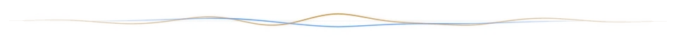
  </picture>

  A Windows-focused RenderDoc derivative for reproducible builds, early graphics capture, and focused replay analysis.

  
  
  
  
  

RenderDox is a Windows-focused fork of [RenderDoc](https://github.com/baldurk/renderdoc) for graphics capture and replay, with an enhanced desktop interface, early capture options, and LLM-driven analysis. Its isolated runtime and desktop application are branded **DComp** and **DCompUI**.

The fork tracks the **RenderDoc v1.x development branch** through [`5ad608809`](https://github.com/baldurk/renderdoc/commit/5ad608809c9028da9f5c5082397cb6afe9c8dd17). The native source reports version **`1.48`**. RenderDox is independently maintained and keeps the upstream `.rdc` capture workflow.

  <a href="https://github.com/dotm5/renderdox/releases">Download portable releases</a> ·
  <a href="USAGE.md">Usage guide</a> ·
  <a href="tools/renderdoc-mcp/README.md">MCP reference</a> ·
  <a href="#screenshots">Screenshots</a> ·
  <a href="#frame-showcase">Frame showcase</a>

[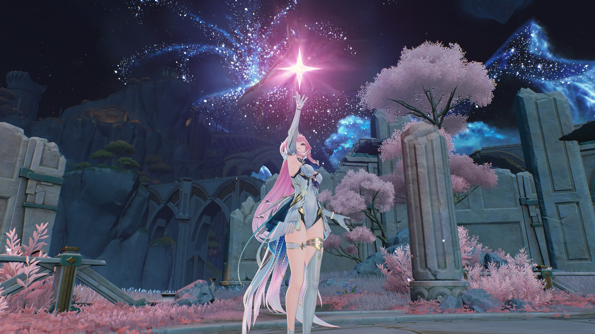](assets/showcase/scene-01.jpg)

  <em>DCompUI frame captures across Wuthering Waves, Strinova, and Honkai: Star Rail — from an 18-index HDR draw to reversed-Z depth, 6-target G-buffers, and pre-HUD swapchain readbacks.</em>

Features
--------

| Area | What RenderDox adds |
| --- | --- |
| **Desktop interface** | Modern Light styling, updated icon states, Chinese localisation, and compact capture and pipeline summaries |
| **Early capture** | Four optional Windows x64 bootstrap proxies (`dxgi.dll`, `d3d11.dll`, `d3d12.dll`, `GFSDK_Aftermath_Lib.x64.dll`), alongside direct capture and child-process propagation |
| **Windows hook performance** | `SafetyHook` and `Zydis`, indexed `GetProcAddress` lookups, and direct proxy forwarding after initialization |
| **Portable distribution** | Windows x64 `MSVC` and `ClangCL` ZIPs bundling Python, `PySide2`/`Shiboken2`, Qt plugins, the MCP service, and **Proxy Builder `0.4.1`** with seven x64 DLL profiles |
| **MCP capture and replay** | `72` tools in **MCP `0.3.2`** for capture sequences, pipeline and resource queries, post-VS geometry, pixel history, and shader debugging |
| **Cross-capture investigation** | Event and resource alignment, draw contribution masks, paired pixel-shader trace comparisons, GPU counters, and constant timelines |
| **Analysis export** | Annotated evidence bundles with Markdown/HTML reports, JSON, images, and ZIP archives; GPU counter results also export as interactive offline HTML reports |

The MCP service exposes its tools over `stdio` and runs native replay and target control in separate worker processes, bundled with Chinese and English rendering-analysis guides. The CLI supports direct tool calls and can print the MCP client configuration. Capture support for `D3D11`, `D3D12`, `Vulkan`, `OpenGL`, and `OpenGL ES` derives from upstream; shader debugging and GPU counters depend on the replay backend.

<table>
  <tr>
    <td width="25%" align="center" valign="top">
       
      <strong><a href="#wuthering-waves--the-star-on-aemeaths-fingertip">HDR draw delta</a></strong>
    </td>
    <td width="25%" align="center" valign="top">
      <a href="#strinova--poolside-with-chiyo-in-lebrun-city">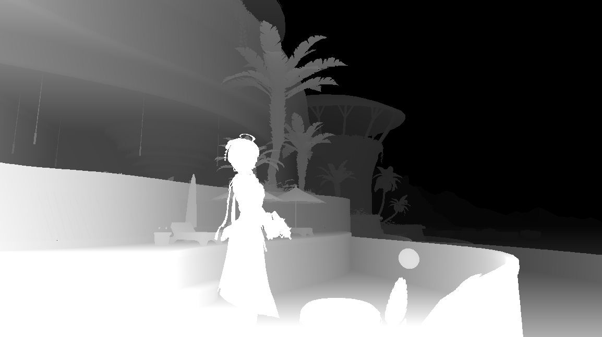</a> 
      <strong><a href="#strinova--poolside-with-chiyo-in-lebrun-city">Reversed-Z depth</a></strong>
    </td>
    <td width="25%" align="center" valign="top">
       
      <strong><a href="#micheles-pawtector--mesh-inspection">Mesh VS input/output</a></strong>
    </td>
    <td width="25%" align="center" valign="top">
       
      <strong><a href="#g-buffer-outputs--windy-town-and-celestias-desk">6-target G-buffer</a></strong>
    </td>
  </tr>
</table>

  

Download and documentation
--------------------------

The [portable releases](https://github.com/dotm5/renderdox/releases) ship Windows x64 ZIPs for `MSVC` and `ClangCL`, a file manifest, and `SHA-256` checksums. Both packages bundle the desktop and MCP runtimes and run without a system Python installation.

| Guide | Contents |
| --- | --- |
| [Using RenderDox](USAGE.md) | First run, package layout, proxy/direct injection, MCP setup, and release builds |
| [Bootstrap reference](bootstrap/README.md) | Proxy deployment, activation, and forwarding behavior |
| [Portable MCP reference](tools/renderdoc-mcp/README.md) | Tool parameters, capture jobs, diff, alignment, and optional GUI bridge |
| [Windows build scripts](util/buildscripts/README.md) | Build and packaging commands |

Screenshots
-----------

### Desktop replay

A standard replay workflow in **DCompUI** on the same `D3D11` capture — selecting a draw event, inspecting pipeline state, examining mesh geometry, and tracing the swap-chain resource — shown in the Modern Light theme with the bundled Chinese localisation.

<table>
  <tr>
    <td width="50%" valign="top">
       
      <strong>Texture Viewer</strong> — replayed output and pixel context
    </td>
    <td width="50%" valign="top">
       
      <strong>Pipeline State</strong> — input layout and graphics stages
    </td>
  </tr>
  <tr>
    <td width="50%" valign="top">
      <a href="docs/imgs/Screenshots/DCompMeshViewer.jpg">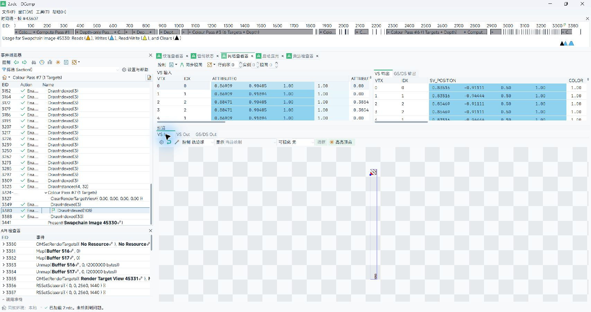</a> 
      <strong>Mesh Viewer</strong> — vertex input/output inspection at the selected draw
    </td>
    <td width="50%" valign="top">
       
      <strong>Resource Inspector</strong> — swap-chain creation, usage, and capture metadata
    </td>
  </tr>
</table>

### MCP analysis outputs

Generated by the portable **MCP `0.2.0`** service from a `D3D11` capture session (`2026-09-30`). Each preview links to its full-resolution output; the binary mask isolates modified pixels in the selected render target rather than segmenting the character.

<table>
  <tr>
    <td width="50%" valign="top">
      <a href="assets/readme/mcp-draw-contribution.png">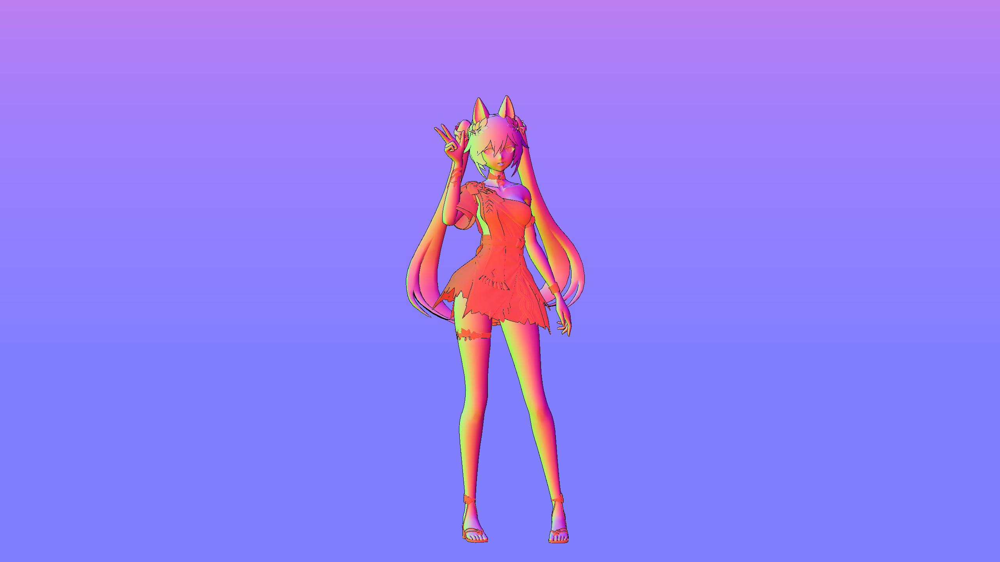</a> 
      <strong>Draw contribution</strong> — highlighted output changes from one selected draw
    </td>
    <td width="50%" valign="top">
       
      <strong>Numeric change mask</strong> — <code>61,385</code> modified pixels marked in white on the selected output
    </td>
  </tr>
</table>

Across captures: shader constant timeline

[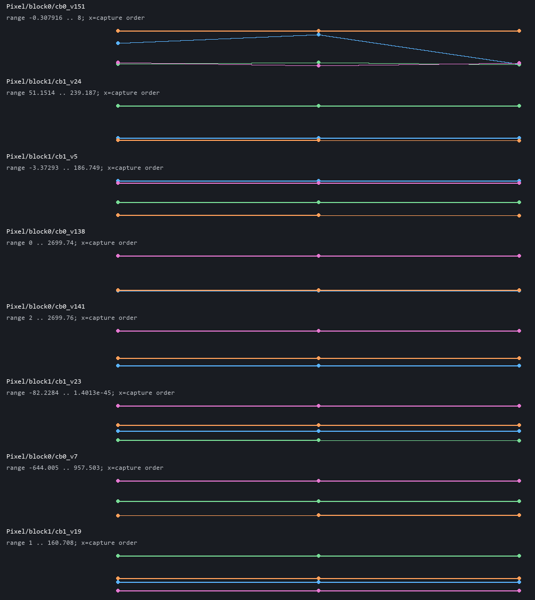](assets/readme/mcp-constant-timeline.png)

Aligned draws track changing pixel-shader constants across three captures. The horizontal axis follows capture order, with each variable scaled to its printed vertical range; exact values export to `JSON` and `CSV`.

  <picture>
    <source media="(prefers-color-scheme: dark)" srcset="assets/readme/dividers/mowing-wave-dark.webp">
    
  </picture>

Frame showcase
--------------

### Wuthering Waves · The star on Aemeath’s fingertip

Captured on the roof above Lorelei’s courtyard in Ragunna (`D3D12`). With the character silhouette and blue arc already drawn across the ruins, the sky above her fingertip stays dark through most of **Colour Pass #19 (2 Targets + Depth)**. **`EID 7981`** — a single `18`-index, `1`-instance `DrawIndexedInstanced()` call writing to color targets `87418` and `87424` (depth `87393`) — ignites the core.

The bloom drives linear HDR values well past `1.0`: point samples on `R16G16B16A16_FLOAT` attachment `87418` at `EID 7981` read `(1924, 435) ≈ (7.02, 3.33, 8.55)` and `(1925, 405) ≈ (10.38, 3.28, 7.09)`. Both views inspect `87418` in RGB (`0–1.25` display range, gamma override off).

<table>
  <tr>
    <td width="50%" valign="top">
       
      <strong><code>EID 7861</code></strong> · Faint arc across the ruins; the sky above her finger remains dark.
    </td>
    <td width="50%" valign="top">
       
      <strong><code>EID 7981</code></strong> · <code>18</code> indices later, the HDR core and glow lock into place.
    </td>
  </tr>
</table>

Pass-wide vs. final-draw delta &amp; gamma comparison

Between the fingertip and the treeline, all `37` draws (`EID 7454 → 7981`, measured against baseline `EID 7453`) spill across the sky, whereas the final `18`-index draw tightens into a compact halo around the star. Red marks pixels whose maximum absolute linear RGB delta exceeds `0.05` on `3840 × 2160` `R16G16B16A16_FLOAT` (`87418`). Each overlay links to its raw binary mask.

<table>
  <tr>
    <td width="50%" valign="top">
       
      <strong>Entire pass · 37 draws</strong> 
      <code>EID 7453</code> baseline → <code>7981</code> (draws <code>7454–7981</code>) · <code>904,323</code> pixels (<code>10.90%</code>).
    </td>
    <td width="50%" valign="top">
       
      <strong>Final draw</strong> 
      <code>EID 7969</code> → <code>7981</code> · <code>32,742</code> pixels (<code>0.39%</code>), concentrated around the star.
    </td>
  </tr>
</table>

[Gamma override comparison at `EID 7981` (on vs. off)](assets/showcase/gamma-comparison.jpg)

### Strinova · Poolside with Chiyo in Lebrun City

A `D3D11` **reversed-Z depth** readback along the curved pool in Lebrun City (`Chiyo`). Across the `3840 × 2160` `D32S8_TYPELESS` target (`94536`, bound alongside six color outputs at `EID 5371`), near geometry maps to bright values while the deck curve and distant palms fall off toward `0`. Each preview links to its full **DCompUI** window.

<table>
  <tr>
    <td width="50%" valign="top">
       
      <strong>Scene color</strong> · <code>D3D11</code>, <code>EID 6772</code> · output <code>552</code> (<code>R10G10B10A2_UNORM</code>), pre-HUD.
    </td>
    <td width="50%" valign="top">
       
      <strong>Depth</strong> · <code>D3D11</code>, <code>EID 5371</code> · attachment <code>94536</code> (<code>D32S8_TYPELESS</code>), reversed-Z readback across <code>0–0.0018</code>.
    </td>
  </tr>
</table>

### Michele’s Pawtector · Mesh inspection

Two pixel picks on Michele’s Pawtector across the dorm table resolve to **`EID 1219`** inside **Colour Pass #3 (6 Targets + Depth)** — a single indexed draw of `16,302` indices. **VS Input** preserves the ears and rounded chassis in raw wireframe; **VS Output** magnifies the transformed vertices in frame.

<table>
  <tr>
    <td width="33.3%" valign="top">
      <a href="assets/showcase/scene-04.jpg">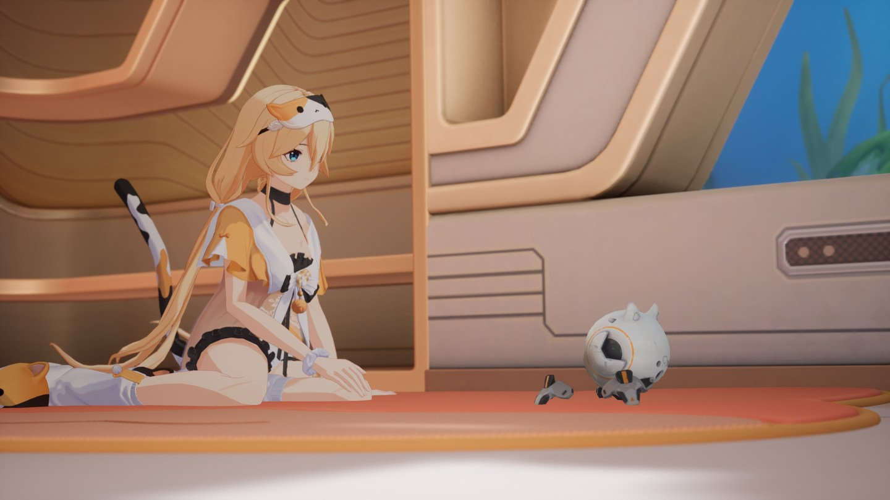</a> 
      <strong>Scene reference</strong> 
      Tabletop framing of Michele’s Pawtector.
    </td>
    <td width="33.3%" valign="top">
       
      <strong>VS Input</strong> 
      Raw wireframe entering the vertex shader (<code>16,302</code> indices).
    </td>
    <td width="33.3%" valign="top">
      <a href="assets/showcase/pet-vsout.png">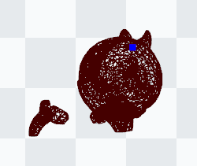</a> 
      <strong>VS Output</strong> 
      Magnified view of the transformed vertices.
    </td>
  </tr>
</table>

### G-buffer outputs · Windy Town and Celestia’s desk

Two 6-target intermediate outputs stripped out prior to final shading. Around a street corner in Windy Town (`Eika`, `EID 5270`), walls that blend seamlessly in scene color split into distinct shades in the 2nd recorded color output (`169936`, `R10G10B10A2_UNORM`). In the aquarium room (`Celestia`, `EID 2989`), the 3rd recorded output (`9737`, `B8G8R8A8_TYPELESS`, viewed as `UNorm`) isolates her silhouette in sharp magenta before glass reflections and lighting reassemble the frame.

<table>
  <tr>
    <td width="50%" valign="top">
       
      <strong>Windy Town · Eika</strong> · <code>EID 5270</code> · 2nd of 6 outputs, attachment <code>169936</code> (<code>R10G10B10A2_UNORM</code>).
    </td>
    <td width="50%" valign="top">
       
      <strong>Aquarium room · Celestia</strong> · <code>EID 2989</code> · 3rd of 6 outputs, attachment <code>9737</code> (<code>B8G8R8A8_TYPELESS</code>, <code>UNorm</code> view).
    </td>
  </tr>
  <tr>
    <td width="50%" valign="top">
       
      <strong>Scene color</strong> · Windy Town
    </td>
    <td width="50%" valign="top">
      <a href="assets/showcase/scene-07.jpg">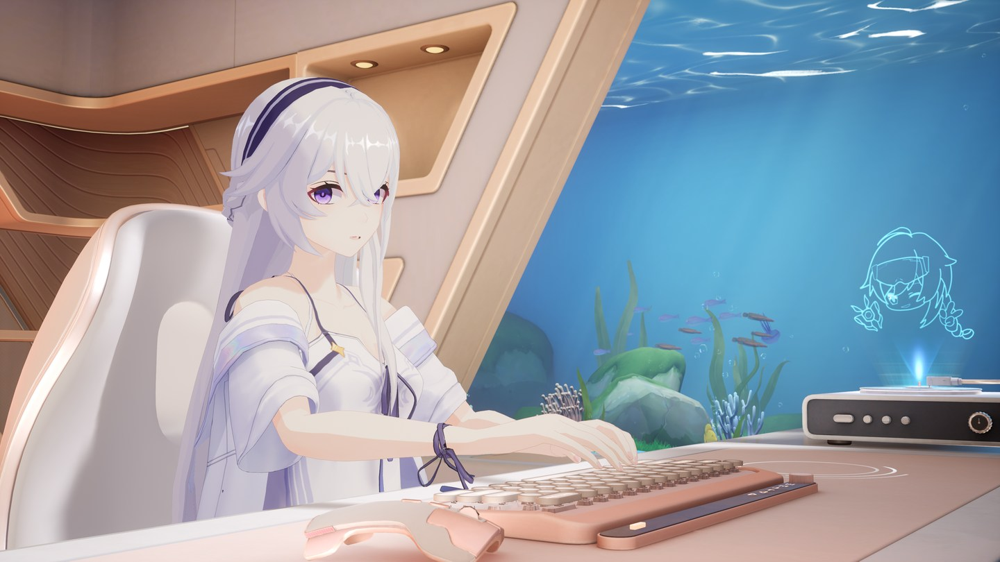</a> 
      <strong>Scene color</strong> · Aquarium room
    </td>
  </tr>
</table>

### Swapchain A/B diff · Kanami and Celestia

Two characters seated at the same sunlit desk provide a controlled screen-space A/B comparison: the potted plant and furniture stay anchored while Kanami (`EID 3349`) swaps out for Celestia (`EID 3204`). Both `D3D11` captures intercept the `R10G10B10A2_UNORM` swapchain target immediately after a single `3`-index scene draw hits the cleared target, prior to HUD composition. The diff also reflects screen-space sensitivity — subtle camera drift and the ticking desk clock register alongside the character swap.

<table>
  <tr>
    <td width="33.3%" valign="top">
      <a href="assets/showcase/studio-gold.jpg">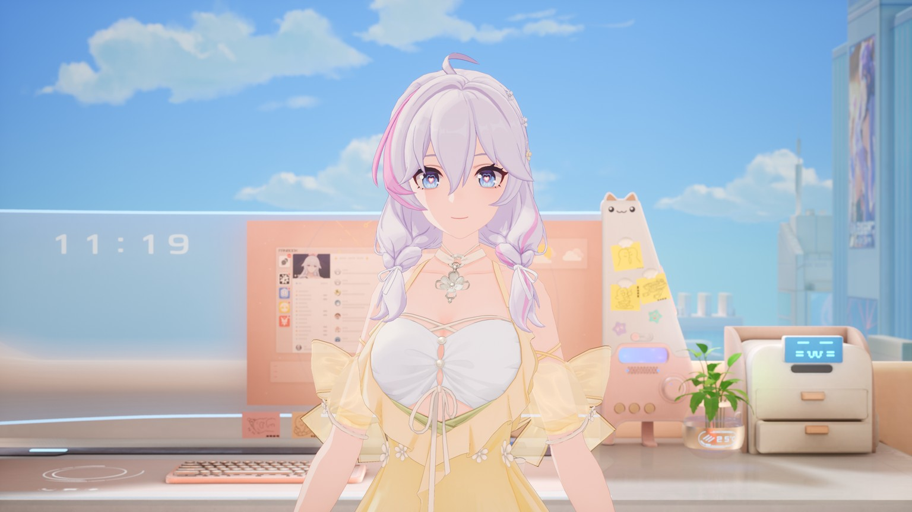</a> 
      <strong>Kanami</strong> · <code>D3D11</code>, <code>EID 3349</code> 
      Swapchain target <code>45330</code> (<code>R10G10B10A2_UNORM</code>).
    </td>
    <td width="33.3%" valign="top">
       
      <strong>Celestia</strong> · <code>D3D11</code>, <code>EID 3204</code> 
      Swapchain target <code>523</code> (<code>R10G10B10A2_UNORM</code>).
    </td>
    <td width="33.3%" valign="top">
       
      <strong>Side view</strong> · <code>D3D11</code>, <code>EID 4757</code> 
      Swapchain target <code>523</code>; aligns keyboard edge and aquarium glass.
    </td>
  </tr>
</table>

The [full-resolution difference mask](assets/showcase/studio-change-mask.png) marks `41.77%` of pixels in white across two `2560 × 1440` 10-bit RGB swapchain readbacks converted to 8-bit RGB, flagging any pixel where an 8-bit channel has an absolute difference `> 24`.

Pre-HUD gallery
---------------

HUD-free frames across `D3D11` and `D3D12` — combining pre-presentation intermediate color targets from *Honkai: Star Rail* and *Wuthering Waves* with clean scene-color captures across combat, rooftop, and interior lighting setups.

<table>
  <tr>
    <td width="33.3%" valign="top">
       
      <strong>Astral Express · Honkai: Star Rail</strong> 
      <code>D3D11</code>, <code>EID 2125</code> · intermediate target <code>1009</code> (<code>R8G8B8A8_TYPELESS</code>, ahead of <code>1004</code>). High-contrast lunar silhouette cut by warm carriage windows.
    </td>
    <td width="33.3%" valign="top">
       
      <strong>Taoyuan Vale · Wuthering Waves</strong> 
      <code>D3D12</code>, <code>EID 23333</code> · intermediate target <code>421</code> (<code>R10G10B10A2_UNORM</code>, ahead of <code>418</code>). Sunlit canopy over a cool, shaded stone path.
    </td>
    <td width="33.3%" valign="top">
      <a href="assets/showcase/gallery/wuthering-waves/denia-lorelei-rooftop.jpg">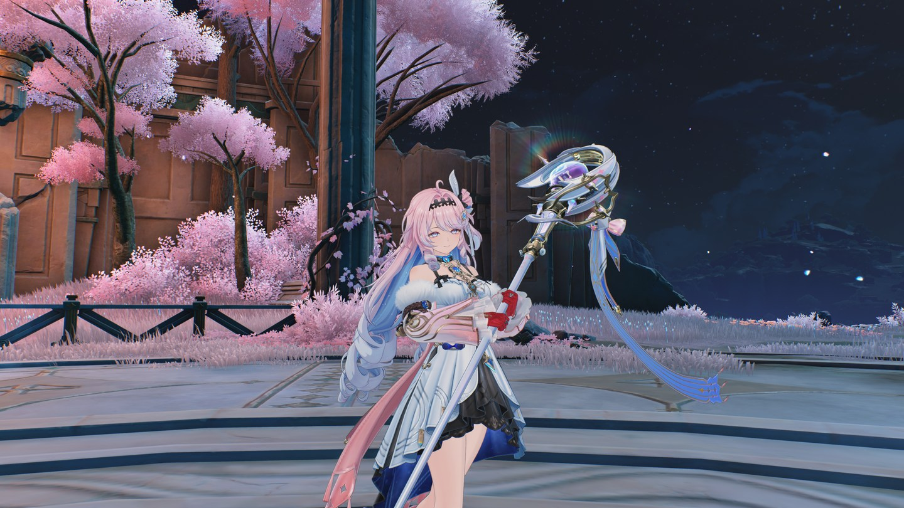</a> 
      <strong>Denia · Wuthering Waves</strong> 
      Night rooftop capture; a gap in foreground blossoms frames the bright crescent staff tip against dark sky.
    </td>
  </tr>
  <tr>
    <td width="33.3%" valign="top">
      <a href="assets/showcase/gallery/honkai-star-rail/march-7th-bow.jpg">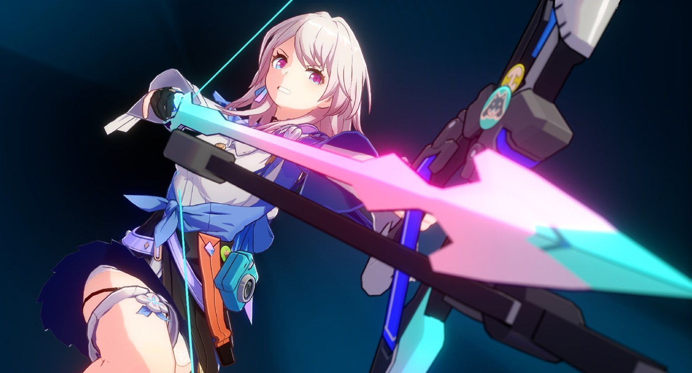</a> 
      <strong>March 7th · Honkai: Star Rail</strong> 
      Emissive cyan bowstring cutting cleanly across the pink bow limb mid-draw.
    </td>
    <td width="33.3%" valign="top">
       
      <strong>Trailblazer · Honkai: Star Rail</strong> 
      Mid-swing combat capture with sharp electric-blue rim light along the dark coat edge.
    </td>
    <td width="33.3%" valign="top">
      <a href="assets/showcase/gallery/honkai-star-rail/march-7th-portrait.jpg">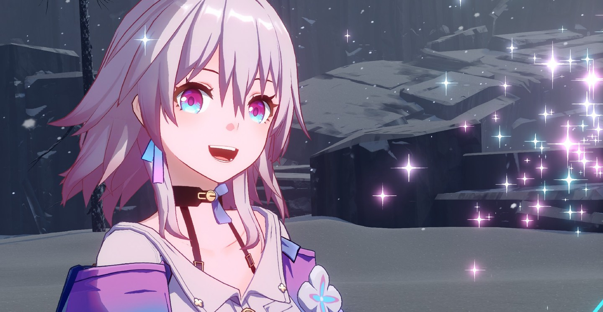</a> 
      <strong>March 7th · Honkai: Star Rail</strong> 
      Close-up in soft diffuse winter light with zero UI overlay.
    </td>
  </tr>
  <tr>
    <td width="33.3%" valign="top">
      <a href="assets/showcase/gallery/strinova/dorm/lawine-red-flower.jpg">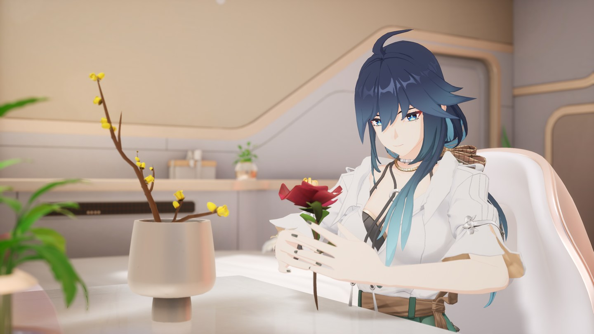</a> 
      <strong>Lawine · Strinova</strong> 
      Interior frame anchoring a single saturated red accent against high-key white gloves and cool fill.
    </td>
    <td width="33.3%" valign="top">
      <a href="assets/showcase/gallery/strinova/dorm/kokona-cards.jpg">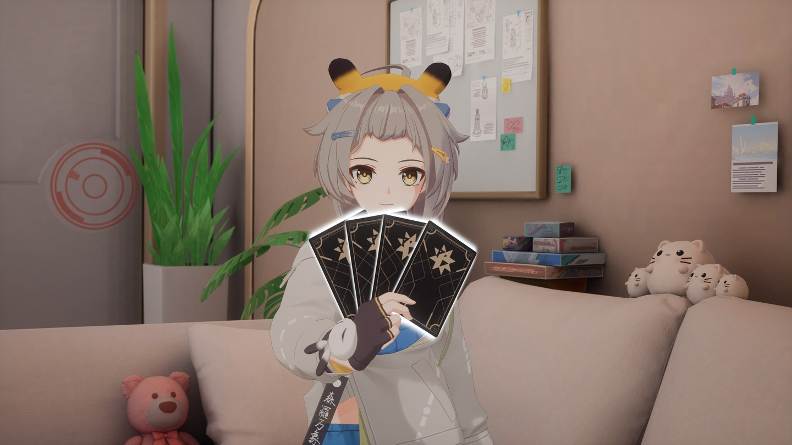</a> 
      <strong>Kokona · Strinova</strong> 
      Warm indoor sofa lighting framing the fanned cards against a muted backdrop.
    </td>
    <td width="33.3%" valign="top">
       
      <strong>Michele · Strinova</strong> 
      Split warm-and-cool interior lighting balancing ambient highlights against the blue monitor glow.
    </td>
  </tr>
</table>

  

Project and upstream
--------------------

- [RenderDox issues](https://github.com/dotm5/renderdox/issues)
- Upstream RenderDoc: [repository](https://github.com/baldurk/renderdoc) · [documentation](https://renderdoc.org/docs)
- [Development notes](docs/CONTRIBUTING.md)

License
-------

RenderDox is derived from RenderDoc and distributed under the MIT license. See [LICENSE.md](LICENSE.md) for the full text and third-party acknowledgements.