<h1 align="center">RenderDox</h1>

  A Windows-focused RenderDoc derivative for reproducible builds, early graphics capture, and focused replay analysis.

  
  
  
  
  

RenderDox is a Windows-focused fork of [RenderDoc](https://github.com/baldurk/renderdoc) for graphics capture and replay, with an enhanced desktop interface, early capture options, and LLM-driven analysis. Its isolated runtime and desktop application are branded **DComp** and **DCompUI**.

The fork tracks the **RenderDoc v1.x development branch** through [`5ad608809`](https://github.com/baldurk/renderdoc/commit/5ad608809c9028da9f5c5082397cb6afe9c8dd17). The native source reports version **1.48**. RenderDox is independently maintained and keeps the upstream `.rdc` capture workflow.

  <a href="https://github.com/dotm5/renderdox/releases">Download portable releases</a> ·
  <a href="USAGE.md">Usage guide</a> ·
  <a href="tools/renderdoc-mcp/README.md">MCP reference</a> ·
  <a href="#screenshots">Screenshots</a> ·
  <a href="#frame-showcase">Frame showcase</a>

DCompUI frame analysis across *Wuthering Waves*, *Strinova*, and *Honkai: Star Rail* spans an 18-index HDR star, reversed-Z depth, MRT outputs, and HUD-free swapchain readbacks.

Features
--------

| Area | What RenderDox adds |
| --- | --- |
| Desktop interface | Modern Light styling, modern icon states, Chinese localisation, and compact capture and pipeline summaries |
| Early capture | The Windows x64 build includes four optional bootstrap proxies: `dxgi.dll`, `d3d11.dll`, `d3d12.dll`, and `GFSDK_Aftermath_Lib.x64.dll`. Direct capture and child-process capture are also supported. |
| Windows hook performance | SafetyHook and Zydis, indexed GetProcAddress lookups, and direct proxy forwarding after initialization |
| Portable distribution | Windows x64 MSVC and ClangCL ZIPs with Python, PySide2/Shiboken2, Qt plugins, the MCP service, and Proxy Builder 0.4.1 with seven x64 DLL profiles |
| MCP capture and replay | 72 tools in MCP 0.3.2 for capture sequences, pipeline and resource queries, post-VS geometry, pixel history, and shader debugging |
| Cross-capture investigation | Event and resource alignment, draw contribution masks, paired pixel-shader trace comparisons, GPU counters, and constant timelines |
| Analysis export | Annotated evidence bundles with Markdown and HTML reports, JSON, images, and a ZIP archive. GPU counter results can also be exported as an interactive offline HTML report. |

The MCP service exposes its tools over stdio and runs native replay and target control in worker processes. It includes Chinese and English rendering-analysis guides. Capture support for D3D11, D3D12, Vulkan, OpenGL, and OpenGL ES comes from upstream. Shader debugging and GPU counters depend on the replay backend.

| [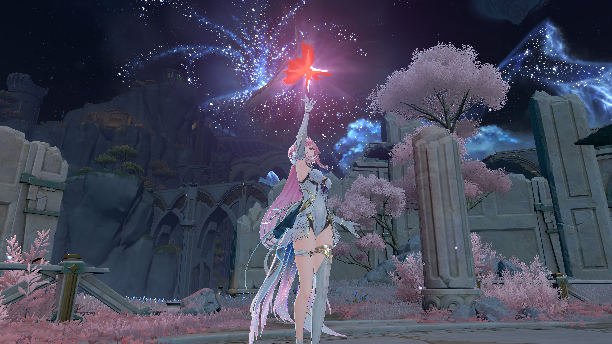](#wuthering-waves--the-star-on-aemeaths-fingertip) **HDR draw delta** |  **Reversed-Z depth** | [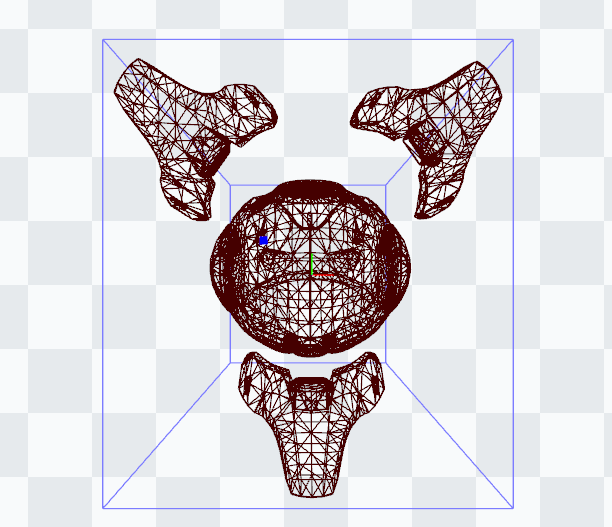](#micheles-pawtector--mesh-inspection) **Mesh VS input/output** | [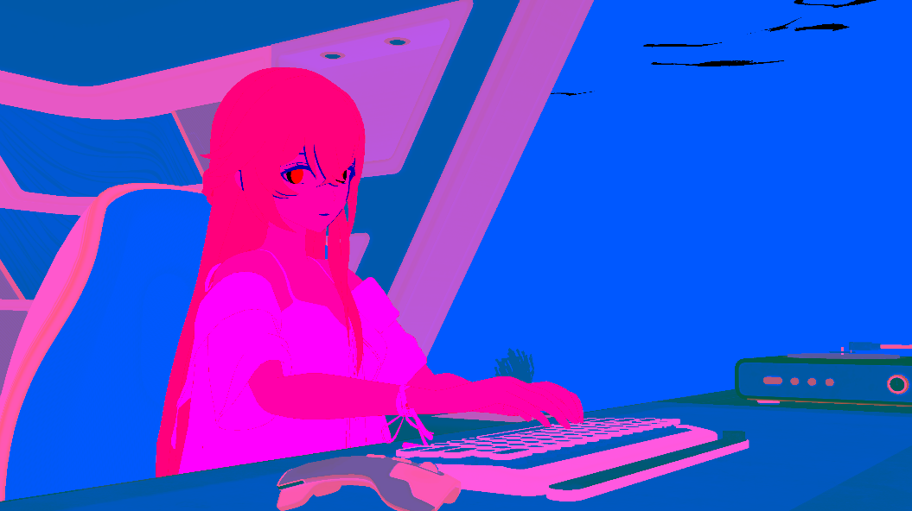](#g-buffer-outputs--windy-town-and-celestias-desk) **6-target G-buffer** |
| --- | --- | --- | --- |

Download and documentation
--------------------------

The [portable releases](https://github.com/dotm5/renderdox/releases) include Windows x64 ZIPs for MSVC and ClangCL, a manifest, and SHA-256 checksums. Both packages bundle the desktop and MCP runtimes and run without a system Python installation.

| Guide | Contents |
| --- | --- |
| [Using RenderDox](USAGE.md) | First run, package layout, proxy/direct injection, MCP setup and release builds |
| [Bootstrap reference](bootstrap/README.md) | Proxy deployment, activation and forwarding behavior |
| [Portable MCP reference](tools/renderdoc-mcp/README.md) | Tool parameters, capture jobs, Diff, alignment and optional GUI bridge |
| [Windows build scripts](util/buildscripts/README.md) | Build and packaging commands |

Screenshots
-----------

### Desktop replay

The screenshots below follow one normal replay workflow in DCompUI: load the same D3D11 capture, select a draw event, inspect its output and pipeline, examine the mesh data, and follow the swap-chain resource. They use the Modern Light interface with the bundled Chinese translation.

| [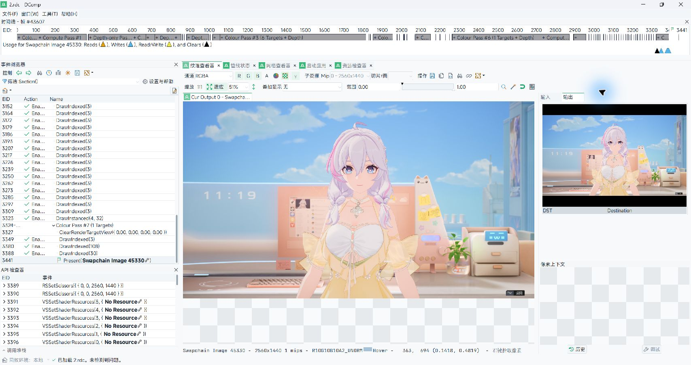](docs/imgs/Screenshots/DCompTextureViewer.jpg) | [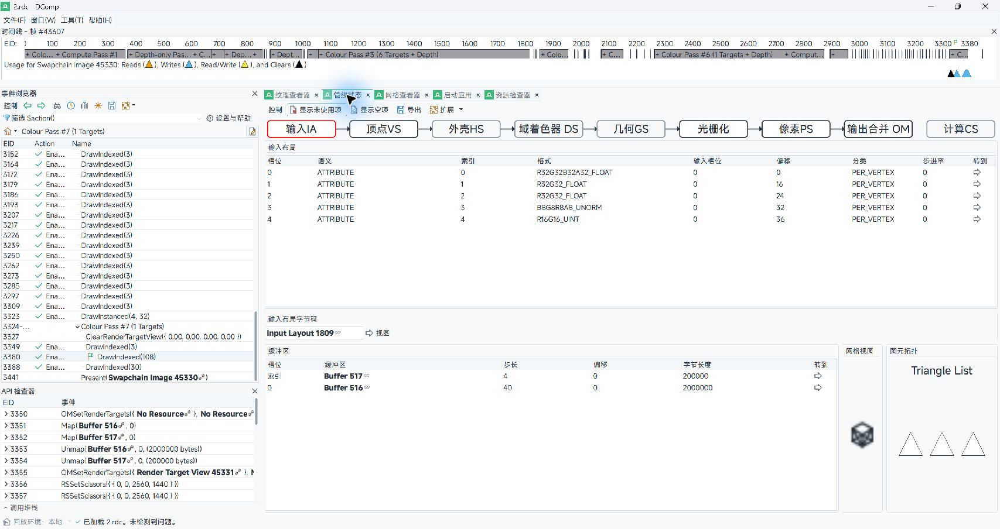](docs/imgs/Screenshots/DCompPipelineState.jpg) |
| --- | --- |
| **Texture Viewer** — replayed output and pixel context | **Pipeline State** — input layout and graphics stages |
|  | [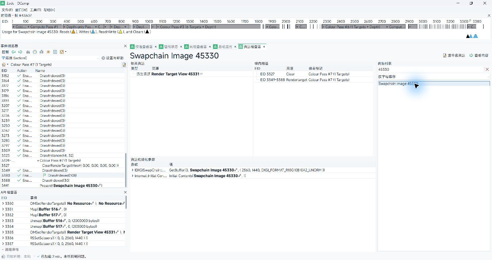](docs/imgs/Screenshots/DCompResourceInspector.jpg) |
| **Mesh Viewer** — vertex input/output inspection at the selected draw | **Resource Inspector** — swap-chain creation, use, and capture metadata |

### MCP analysis outputs

These images were generated by the portable MCP 0.2.0 service from a real D3D11 capture session on 2026-09-30. Each image links to its full-resolution output.

|  | [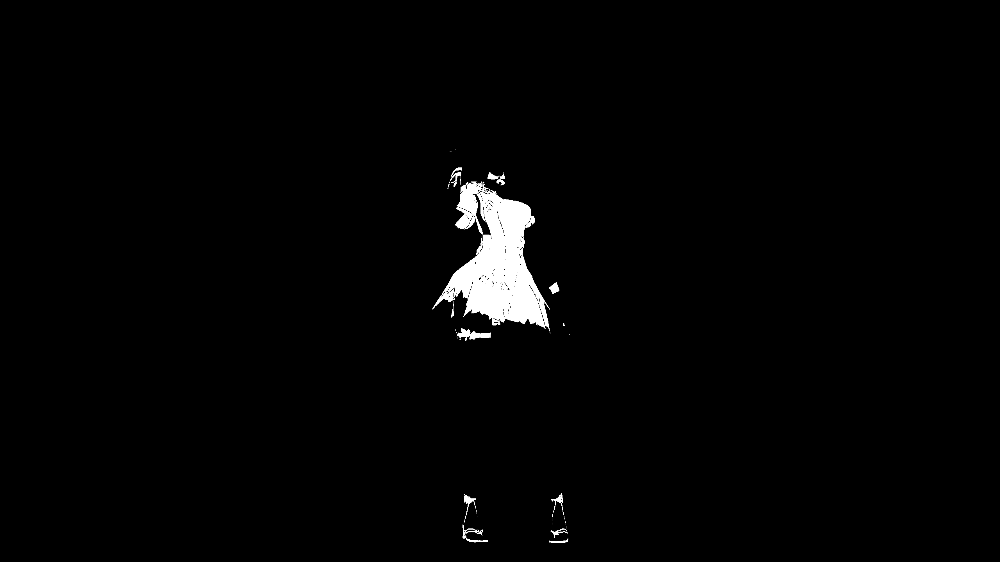](assets/readme/mcp-draw-change-mask.png) |
| --- | --- |
| **Draw contribution** — highlighted output changes from one selected draw | **Numeric change mask** — the same draw changes 61,385 pixels in the selected output; white marks changed pixels |

The mask shows changes in the selected output, rather than a segmentation of the entire character.

Across captures: inspect changing shader constants

Aligned draws reveal changing shader constants across three captures. The horizontal axis is capture order; each variable has its own printed vertical range. Exact values are available in JSON and CSV exports.

Frame showcase
--------------

### Wuthering Waves · The star on Aemeath’s fingertip

A quieter encore after Aemeath’s graduation show at Startorch Academy, captured on the roof above Lorelei’s courtyard at the Atrium of Reflections in Ragunna. Her hand is already raised and the blue arc is etched across the ruins, yet the sky above her fingertip stays dark through most of D3D12 **Colour Pass #19 (2 Targets + Depth)**. **EID 7981**—a single 18-index, 1-instance `DrawIndexedInstanced()` targeting `87418` and `87424` (depth `87393`)—ignites the core.

The pink bloom pushes well past `1.0` in linear HDR: point samples on `R16G16B16A16_FLOAT` attachment `87418` at `EID 7981` measure `(1924, 435) ≈ (7.02, 3.33, 8.55)` and `(1925, 405) ≈ (10.38, 3.28, 7.09)`. Both views inspect `87418` in RGB (`0–1.25` display range, gamma override off).

| [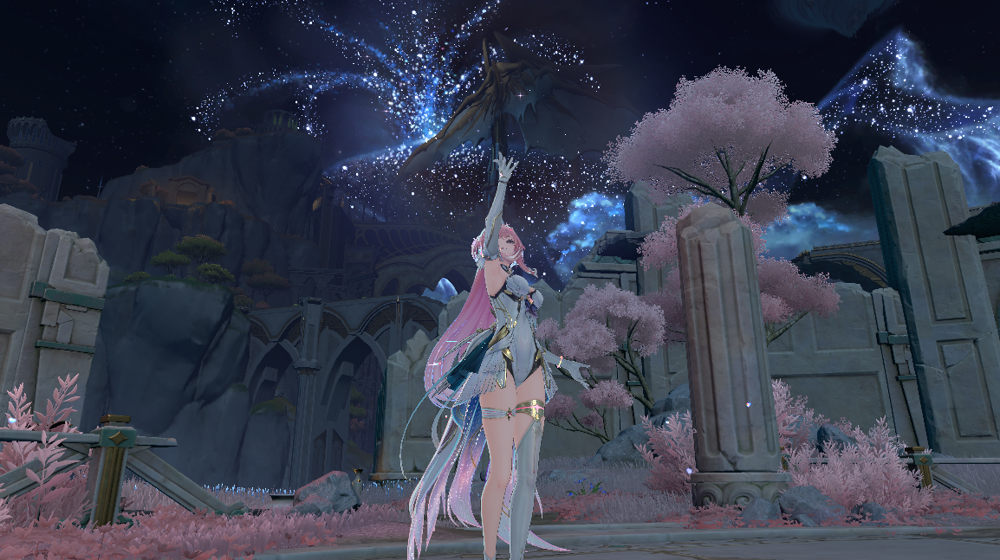](assets/showcase/star-before.png) | [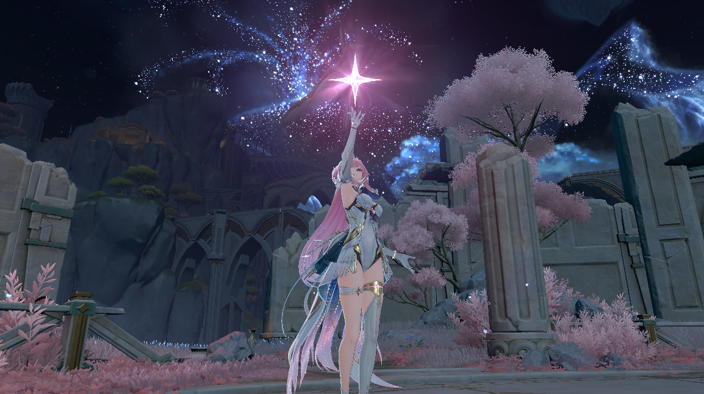](assets/showcase/star-after.png) |
| --- | --- |
| **EID 7861** · Faint arc across the ruins; the sky above her finger remains dark. | **EID 7981** · 18 indices later, the HDR core and glow lock into place. |

Pass-wide vs. final-draw delta & gamma comparison

Between her fingertip and the treeline, all 37 draws (`EID 7454 → 7981`, measured against the `EID 7453` baseline) spill across the sky, while the final 18-index draw tightens into a compact halo around the star. Red highlights pixels whose maximum linear RGB delta exceeds `0.05` on `3840 × 2160` `R16G16B16A16_FLOAT` (`87418`). Each overlay links to its raw binary mask.

| [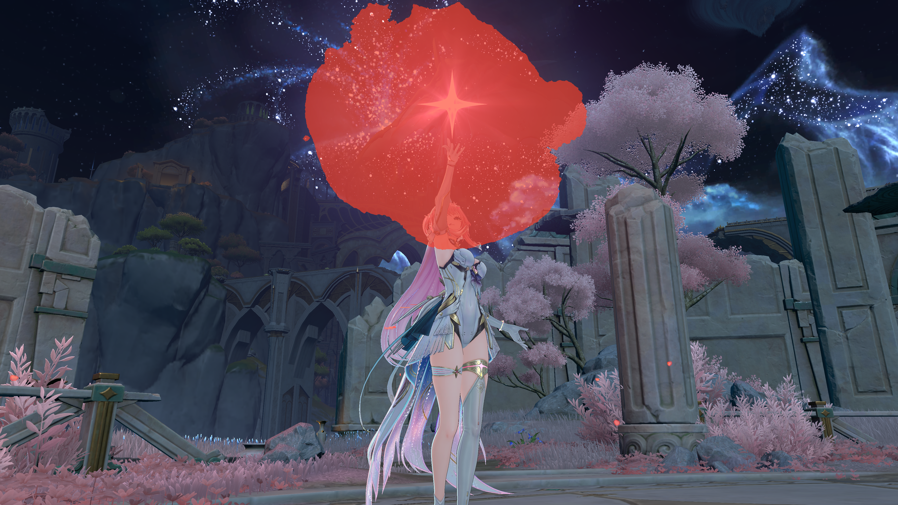](assets/showcase/pass-mask.png) |  |
| --- | --- |
| **Entire pass · 37 draws** · EID 7453 baseline → 7981 (draws 7454–7981) · 904,323 pixels (10.90%). | **Final draw** · EID 7969 → 7981 · 32,742 pixels (0.39%), concentrated around the star. |

[Gamma override comparison at EID 7981 (on vs. off)](assets/showcase/gamma-comparison.jpg)

### Strinova · Poolside with Chiyo in Lebrun City

Superstrings in *Strinova* flatten into 2D on demand, making a D3D11 **reversed-Z depth buffer** an ironic lens for reading Lebrun City. From Chiyo’s perch beside the curved pool, the `3840 × 2160` `D32S8_TYPELESS` target (`94536`, bound alongside six color outputs at `EID 5371`) maps near geometry to bright values while the deck curve and distant palms fall off toward `0`. The left capture shows pre-HUD `R10G10B10A2_UNORM` scene color; each view links to its full DCompUI window.

| [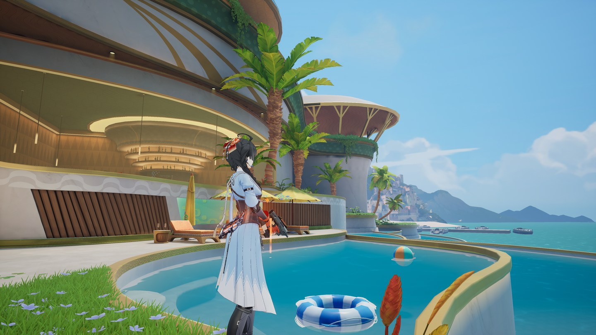](assets/showcase/coast-color.png) |  |
| --- | --- |
| **Scene color** · D3D11, EID 6772 · output `552` (`R10G10B10A2_UNORM`). | **Depth** · D3D11, EID 5371 · attachment `94536` (`D32S8_TYPELESS`). Reversed-Z readback across `0–0.0018`. |

### Michele’s Pawtector · Mesh inspection

Too busy guarding lanes mid-match to sit for a mesh dump, Michele’s Pawtector finally holds still across her dorm table. Two picks on its chassis resolve to **EID 1219** inside **Colour Pass #3 (6 Targets + Depth)**—a single indexed draw of `16,302` indices. **VS Input** preserves the ears and rounded silhouette in raw wireframe; **VS Output** magnifies the transformed vertices in frame.

|  **Dorm scene** · Michele and her Pawtector. |  **VS Input** · Raw geometry entering the vertex shader (`16,302` indices). |  **VS Output** · Magnified view of the transformed vertices. |
| --- | --- | --- |

### G-buffer outputs · Windy Town and Celestia’s desk

A 6-target pass strips away the seamless finish of the final frame. Around a street corner in Eika’s view of Windy Town, walls that merge cleanly in scene color split into distinct shades in the 2nd recorded color output (`169936`, `R10G10B10A2_UNORM`). In the aquarium room—where Celestia catches a quiet break off duty from the Astral Sanctuary—the 3rd output (`9737`, `B8G8R8A8_TYPELESS`, viewed as `UNorm`) isolates her silhouette in sharp magenta before reflections and lighting reassemble the scene.

| [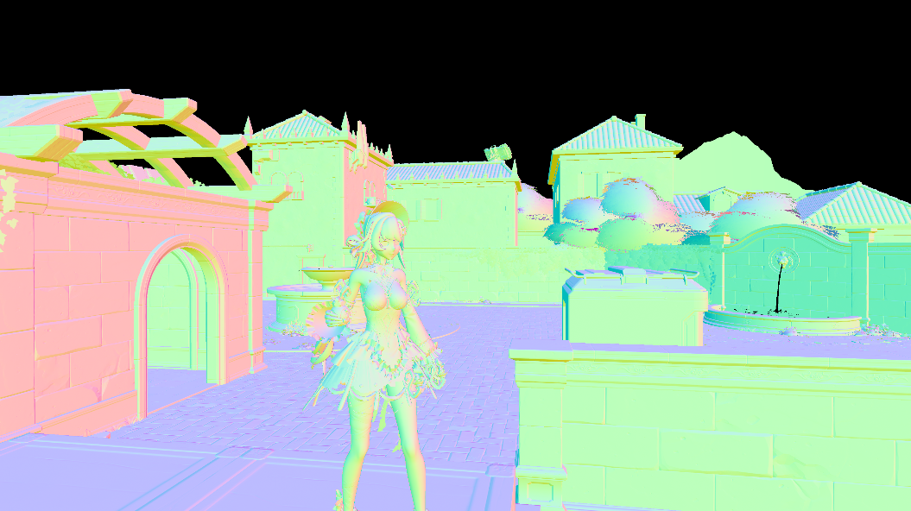](assets/showcase/street-buffer.png) **Windy Town · Eika** · EID 5270 · 2nd of 6 outputs, attachment `169936` (`R10G10B10A2_UNORM`). |  **Aquarium room** · EID 2989 · 3rd of 6 outputs, attachment `9737` (`B8G8R8A8_TYPELESS`, UNorm view). |
| --- | --- |
| [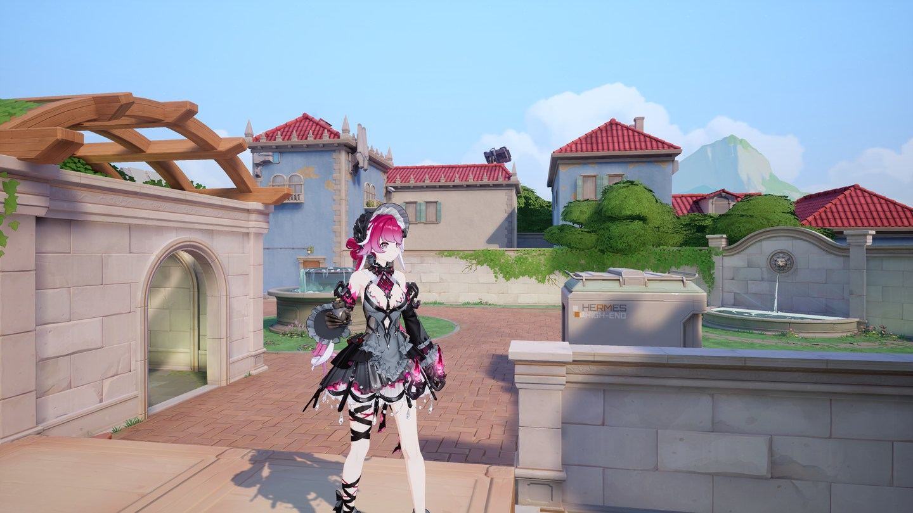](assets/showcase/scene-05.jpg) Eika in Windy Town · scene color |  Aquarium room · scene color |

### Swapchain A/B diff · Kanami and Celestia

Offstage at a sunlit desk, Kanami and Celestia form a clean screen-space A/B benchmark: the potted plant and furniture stay anchored while pink-streaked hair and gold cuffs swap out for white hair and a blue ribbon. Both D3D11 captures intercept the `R10G10B10A2_UNORM` swapchain target immediately after a single 3-index scene draw hits the cleared target, prior to HUD composition. The diff also exposes screen-space sensitivity—subtle camera drift and the ticking desk clock register alongside the character swap.

|  **Kanami offstage** · D3D11, EID 3349 · swapchain target `45330` (`R10G10B10A2_UNORM`). | [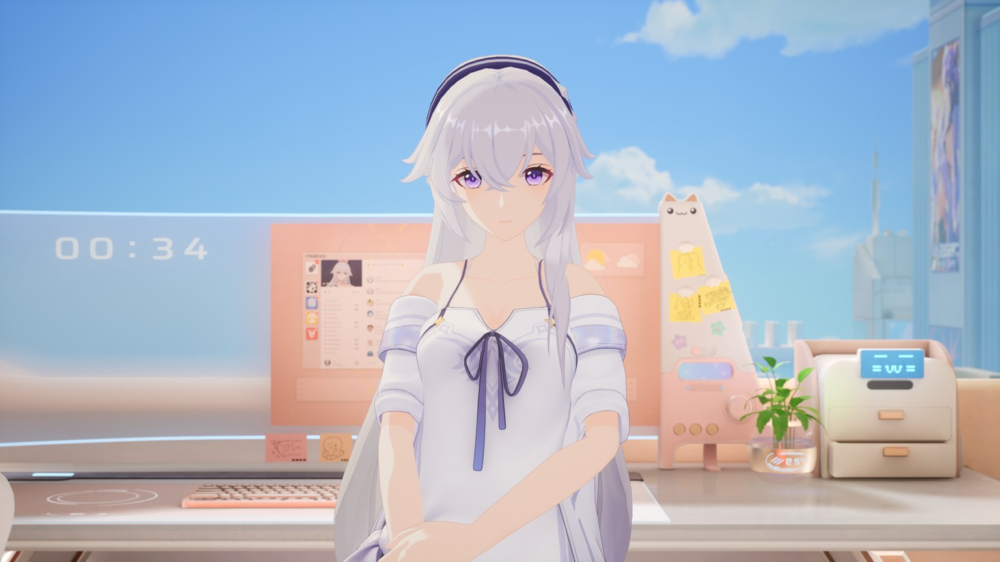](assets/showcase/studio-blue.jpg) **Celestia at the keyboard** · D3D11, EID 3204 · swapchain target `523` (`R10G10B10A2_UNORM`). | [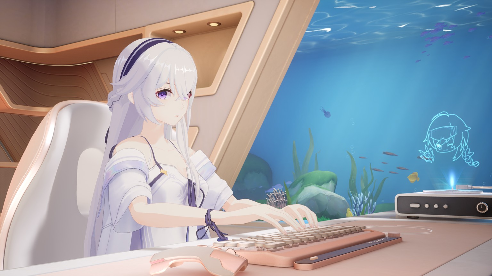](assets/showcase/studio-aquarium.jpg) **Side view** · From Celestia’s side of the desk, the room’s spatial layout aligns in a single pre-HUD swapchain capture (`EID 4757`, target `523`): fingertips, keyboard edge, and aquarium glass. |
| --- | --- | --- |

The [full-resolution difference mask](assets/showcase/studio-change-mask.png) marks `41.77%` of pixels in white across two `2560 × 1440` 10-bit RGB swapchain readbacks converted to 8-bit RGB, flagging any pixel where an 8-bit channel has an absolute difference `> 24`.

Pre-HUD gallery
---------------

Different engines, different graphics APIs, opposite ends of the lighting range. The Astral Express and Taoyuan Vale were captured from intermediate color targets prior to HUD composition and presentation.

March 7th’s camera roll brings together HUD-free frames of March and the Trailblazer, a rooftop detour in Ragunna with Denia, and three quiet Strinova dorm portraits after the match.

| [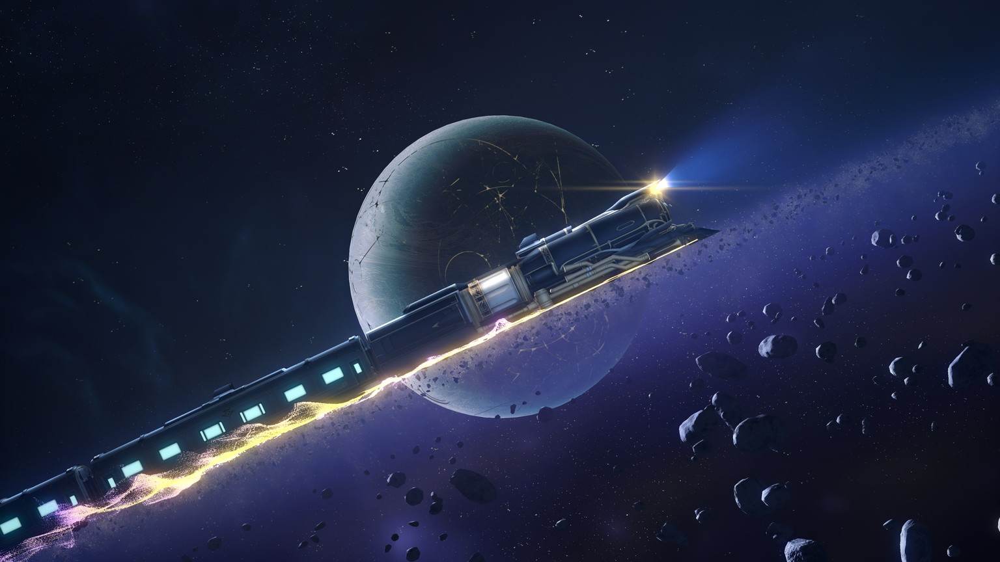](assets/showcase/orbital-train.jpg) **Astral Express · Honkai: Star Rail** · D3D11, EID 2125 · intermediate target `1009` (`R8G8B8A8_TYPELESS`, ahead of presentation resource `1004`). Reduced to a silhouette against the moon, that warm ribbon of carriage windows still spans nearly the full lunar disc. | [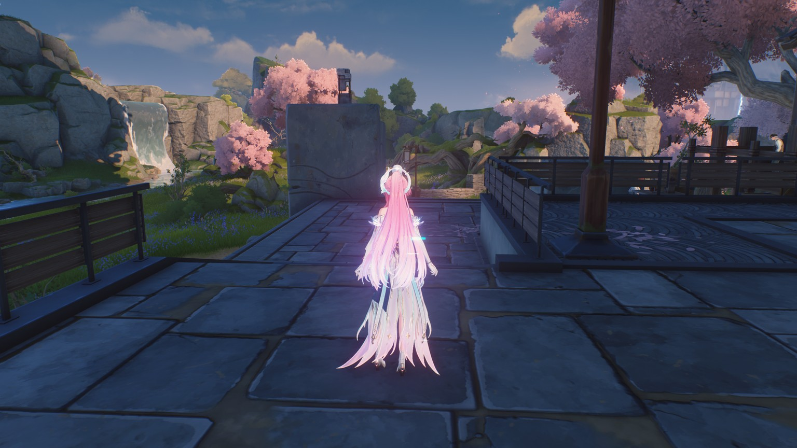](assets/showcase/garden-terrace.jpg) **Aemeath in Taoyuan Vale · Wuthering Waves** · D3D12, EID 23333 · intermediate target `421` (`R10G10B10A2_UNORM`, ahead of presentation resource `418`). A familiar valley from the Moon-Chasing Festival: warm sunlight across the flowering canopy above a shaded stone path. |  **Denia · Wuthering Waves** · Back on Lorelei’s rooftop. Between casts of her starry Resonance Skill, a gap in the blossoms leaves just enough night sky to frame the crescent at the tip of her staff. |
| --- | --- | --- |
|  **March 7th** · Neon-cyan bowstring cutting cleanly past the pink limb of her bow. | [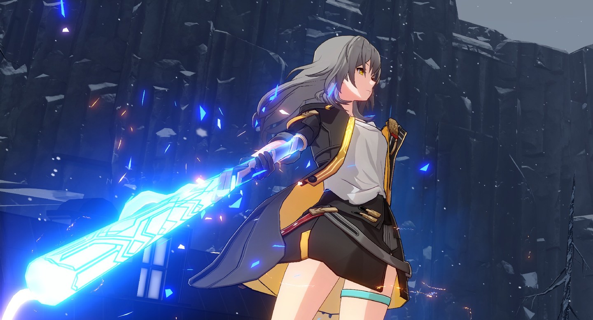](assets/showcase/gallery/honkai-star-rail/trailblazer-bat.jpg) **The Trailblazer** · Single-handed bat swing, with electric-blue rim light carving out the coat edge. |  **March 7th, between shots** · Soft winter light, zero HUD clutter, and an expression brighter than the snow. |
|  **Lawine** · Former P.U.S. investigator holding a single red flower against crisp white gloves. |  **Kokona** · Veteran investigator with a playful streak and an unreadable poker face. | [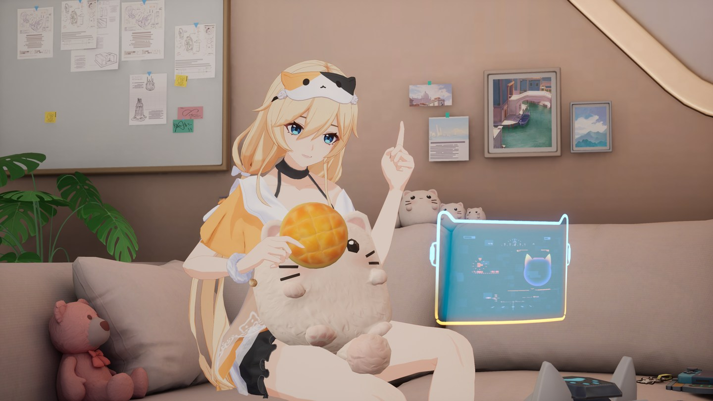](assets/showcase/gallery/strinova/dorm/michele-blue-screen.jpg) **Michele** · Rookie investigator and dedicated gamer; even off the clock, a cool blue monitor claims its share of the lighting. |

Project and upstream
--------------------

- [RenderDox issues](https://github.com/dotm5/renderdox/issues)
- Upstream RenderDoc: [repository](https://github.com/baldurk/renderdoc) · [documentation](https://renderdoc.org/docs)
- [Development notes](docs/CONTRIBUTING.md)

License
-------

RenderDox is derived from RenderDoc and distributed under the MIT license. See [LICENSE.md](LICENSE.md) for the full text and third-party acknowledgements.
